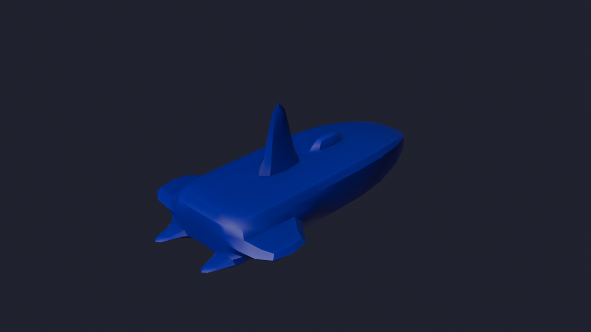
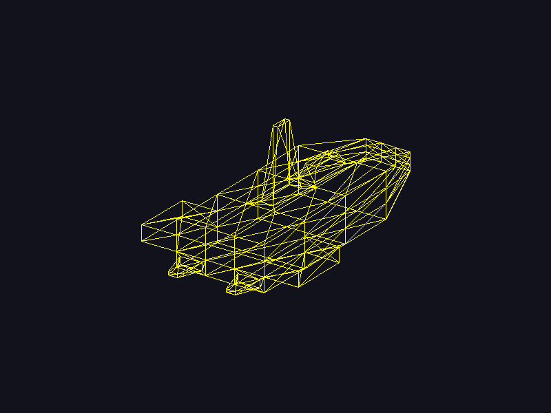

# Lab 3 — Modelo 3D: Nave Espacial

**Samuel Robledo** · Universidad del Valle de Guatemala · Gráficas por Computadora

## Descripción

Nave espacial low poly modelada en Blender a partir de un único cubo, sin agregar ningún otro objeto a la escena.
Toda la forma se obtuvo deformando y extruyendo esa malla inicial.
El acabado combina un material de color base simple con sombreado suave.

## Proceso de modelado

1. **Cuerpo:** el cubo inicial se escaló a lo largo de un eje para formar el fuselaje alargado.
2. **Secciones:** la malla se subdividió para tener bucles de aristas donde trabajar cada parte de la nave.
3. **Nariz:** se extruyó la cara frontal y se escaló hacia adentro para afilar la punta.
4. **Motores laterales:** se extruyeron caras de los costados sobre sus normales para formar las góndolas de propulsión.
5. **Aleta central:** se aplicó un inset sobre la cara superior y se extruyó hacia arriba para levantar la aleta dorsal.
6. **Acabado:** se asignó un material con color base y se suavizó la superficie con modifiers.

## Herramientas utilizadas

- **Move** y **Scale** para dar proporción al cuerpo, la nariz y los motores
- **Extrude** para hacer crecer la nariz, los motores y la aleta
- **Inset** para definir la base de la aleta central
- **Subdivide** para dividir la malla en secciones
- **Modifiers:** Subdivision Surface y Smooth by Angle

## Exportación

El modelo se exportó en formato **Wavefront OBJ** (`nave.obj` + `nave.mtl`) con estas opciones:

- UV Coordinates
- Normals
- Triangulated Mesh

| Vértices | Caras (triángulos) |
|---------:|-------------------:|
| 108      | 212                |

## Render en wireframe

Generado con el software renderer en C++ del Lab 4, que lee `nave.obj` y dibuja cada triángulo con líneas de Bresenham sobre un framebuffer propio.

## Video

<!-- VIDEO AQUÍ -->

## Archivos

| Archivo | Contenido |
|---------|-----------|
| `nave.obj` | Malla exportada en formato Wavefront OBJ |
| `nave.mtl` | Material asociado al OBJ |
| `nave.blend` | Archivo fuente de Blender |
| `screenshots/` | Render en Blender y render en wireframe |
